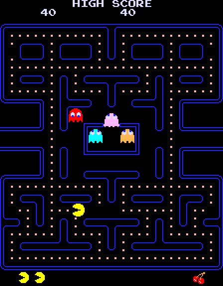

# arcade-core

[English](README.md) | [Español](README.es.md)

`arcade-core` comenzó como un emulador de hardware clásico pensado para ejecutar como bare-metal en dispositivos muy pequeños. La arquitectura original es modular separando procesador de la placa del arcade, audio y video con fin de poder extenderlo fácilmente a otros arcade. La idea es no tener que levantar un OS, ni MAME e ir directamente al juego como si fuera la máquina original.  Fue pensado para una implementación híbrida CPU + FPGA para correr sobre HDMI.

El alcance actual incluye integraciones modulares nativas/FPGA, una distribución JavaScript autocontenida para navegador y un backend nativo standalone Raspberry Pi con imagen Pi 4 suministrada. Su validación física sigue pendiente, separada de las pruebas host/navegador y de la simulación FPGA.

El proyecto está escrito principalmente en:

- C17 para emulación de CPU, placas, máquinas y herramientas host.
- SystemVerilog para el pipeline de vídeo.
- C++17 para los testbenches de Verilator y la integración SDL del RTL.
- JavaScript para el ejemplo independiente de navegador.

Actualmente incluye una implementación funcional de **Pac-Man**, con:

- CPU Z80.
- placa CPU de Pac-Man;
- vídeo, tilemap, sprites y paleta;
- audio Namco WSG de tres voces;
- ejecución de la máquina sincronizada por T-states;
- simulador interactivo SDL;
- ejemplo independiente para navegador en JavaScript;
- pipeline de framebuffer y vídeo 720p en RTL;
- integración Pac-Man → RTL → SDL mediante Verilator.

El objetivo del proyecto no es depender de MAME en tiempo de ejecución. Los componentes de la máquina están implementados dentro de `arcade-core`.

Para la versión web, consulta el [ejemplo JavaScript para navegador](#ejemplo-javascript-para-navegador).

Para Raspberry Pi, consulta el [ejemplo bare-metal](#ejemplo-raspberry-pi-bare-metal).

---

## Estado actual

La implementación actual tiene validados:

- core Z80 mediante pruebas unitarias y ZEXDOC/ZEXALL;
- decoder y mapa de memoria de la placa CPU de Pac-Man;
- interrupciones y VBlank;
- tilemap y sprites;
- raster de Pac-Man;
- ROM set de CPU, vídeo y sonido;
- Namco WSG de tres voces;
- música y efectos de Pac-Man;
- sincronización CPU → vídeo → audio;
- simulador SDL jugable;
- framebuffer RTL;
- cambio de dominio de reloj;
- administración de múltiples framebuffers;
- escalado entero;
- scanout 1280×720;
- efectos CRT;
- integración Pac-Man → `video_system` RTL.

# Estructura del proyecto

La separación principal distingue **componentes comunes**, **integraciones modulares por plataforma** y **distribuciones standalone**. Standalone significa distribución autocontenida; la versión web sigue funcionando dentro de un navegador, no en bare-metal.

```text
arcade-core/
├── common/
│   ├── devices/                 # Z80, Namco WSG
│   ├── boards/                  # Pac-Man CPU, video, audio
│   ├── machines/pacman/
│   ├── romsets/pacman/
│   ├── rtl/                     # generic video pipeline
│   └── roms/                    # one shared local ROM input
│       ├── CHECKSUMS.txt
│       └── pacman/
├── modular/platforms/
│   ├── host/                    # SDL, loaders, Verilator + SDL
│   └── fpga/tangnano20k/         # logical shell; physical FPGA pending
├── standalone/
│   ├── include/                 # platform.h and pacman.h
│   ├── tools/generate_pacman.py  # amalgamate common C, not a second core
│   └── platforms/
│       ├── browser/             # ROM-free JS template and canvas-only HTML
│       └── raspberry_pi/
│           ├── Makefile
│           ├── boot/            # start.S and config.txt
│           ├── include/
│           ├── linker/
│           ├── src/             # platform.c and main.c
│           ├── scripts/         # ROM packaging and boot installers
│           └── examples/pi4_usb/ # first-run documentation
├── tests/
│   ├── common/
│   ├── modular/host/
│   ├── rtl/
│   └── standalone/
│       ├── browser/
│       └── native/
├── scripts/                     # build/verification entry points
├── docs/                        # migration, previews and validation
├── build/                       # generated or supplied artifacts; Git-ignored
│   ├── host/
│   ├── standalone/
│   │   ├── browser/             # index.html + self-contained pacman.js
│   │   ├── native/pacman.c
│   │   └── raspberry_pi/
│   │       ├── generated/roms.c
│   │       ├── model4/clang/     # selected build; model3/gcc also supported
│   │       └── examples/pi4_usb/ # supplied kernel8.img, config, SHA256SUMS
│   └── docs/                    # interactive HTML READMEs
├── Makefile
├── README.md
└── README.es.md
```

## Componentes comunes: `common/`

`devices/` contiene los dispositivos reutilizables Z80 y Namco WSG. `boards/` los conecta con los subsistemas CPU, vídeo y audio de Pac-Man. `machines/pacman/` compone las placas mediante `PacmanMachine`, coordinando entradas y tiempo por T-states. `romsets/pacman/` define las regiones lógicas de las ROMs sin encargarse de leer archivos.

`common/rtl/` contiene el pipeline genérico de vídeo SystemVerilog, sin constraints de pines ni adaptadores físicos de Tang Nano. `common/roms/pacman/` es la **entrada local y privada** compartida por el loader modular nativo, el empaquetador Raspberry Pi standalone y el empaquetador JavaScript; las ROMs quedan ignoradas por Git.

El fuente del navegador es un port separado a JavaScript. **No** importa C ni ejecuta RTL. Compartir las ROMs de entrada no implica que los cambios del motor C se propaguen automáticamente al JavaScript. El generador standalone nativo ahora utiliza los mismos componentes C comunes para producir una única unidad de compilación destinada a Raspberry Pi; su adaptador de hardware permanece separado.

## Integraciones modulares: `modular/platforms/`

`host/` reúne la lectura de archivos, el loader de ROMs, `pacman_sim.c`, `pacman_hdmi_sim.c` y `pacman_video_system_sdl.cpp`. Este último es un adaptador ejecutable del host, por lo que deja de estar mezclado con los testbenches.

`fpga/tangnano20k/` contiene solo la integración específica de placa: shell lógico, entrada de raster RP2350 y documentación de los futuros constraints, memoria, relojes y TMDS. Sigue sin existir un bitstream físico verificado.

## Targets standalone: `standalone/`

`platforms/browser/` contiene la plantilla fuente JavaScript sin ROMs y la página que muestra únicamente el canvas. `make pacman-web` genera un único JavaScript autocontenido y su página HTML en `build/standalone/browser/`.

`include/platform.h` define el contrato nativo de plataforma e `include/pacman.h` expone la API standalone. `tools/generate_pacman.py` amalgama los componentes C comunes en `build/standalone/native/pacman.c`. `platforms/raspberry_pi/` contiene arranque AArch64, linker, driver, empaquetador e instaladores importados. Se suministra la imagen Pi 4; su arranque físico, GPIO, vídeo y audio siguen sin verificar.

## Verificación y archivos generados

Las pruebas reflejan su alcance bajo `tests/common/`, `tests/modular/`, `tests/rtl/` y `tests/standalone/`. Las listas comunes de fuentes e includes nativos están centralizadas en `scripts/common-build.sh`; se conservan los targets originales del Makefile raíz.

Los programas compilados, C generado de core/ROMs, ejemplo Pi 4 suministrado, temporales de pruebas, bundle web y documentación HTML se guardan bajo `build/` raíz. La documentación y los inventarios de migración están en `docs/`.

Consulta las [instrucciones de migración](docs/migration/README.es.md) para ver las rutas anteriores y nuevas, y la lista exacta de archivos obsoletos que debes eliminar después de copiar esta distribución sobre un checkout existente.

---

# Requisitos

Los siguientes requisitos corresponden a las herramientas host nativas y a la simulación RTL. El [ejemplo JavaScript para navegador](#ejemplo-javascript-para-navegador) se ejecuta de forma independiente en el navegador.

En Debian o derivados se necesitan al menos:

```bash
sudo apt install \
    build-essential \
    make \
    pkg-config \
    libsdl2-dev \
    verilator
```

Herramientas utilizadas:

- compilador C con soporte C17;
- compilador C++;
- GNU Make;
- Bash;
- SDL2;
- Verilator.

La lista de paquetes anterior corresponde a los targets host nativos/RTL, no a la compilación cruzada Raspberry Pi. La guía Raspberry Pi documenta el toolchain AArch64 GCC o Clang/LLVM independiente. Para jugar al ejemplo web preparado solo hace falta un navegador. Regenerar su bundle requiere Python 3 y ROMs locales; `make test-web` también requiere Node.js con soporte `node:test` (Node.js 18 o posterior). Generar los README HTML usa la dependencia opcional de `docs/requirements.txt`.

# ROMs de Pac-Man

Las ROM comerciales **no forman parte del repositorio**. Esta distribución privada de trabajo conserva las diez ROMs entregadas con el proyecto en el directorio ignorado `common/roms/pacman/`. No publiques esas ROMs, el C generado que las contiene, los kernels ni el bundle web como parte del repositorio fuente.

Para ejecutar los simuladores nativos de Pac-Man deben colocarse localmente en:

```text
common/roms/pacman/
```

Se esperan estos diez archivos:

```text
pacman.6e
pacman.6f
pacman.6h
pacman.6j
pacman.5e
pacman.5f
82s123.7f
82s126.4a
82s126.1m
82s126.3m
```

Los últimos dos corresponden al subsistema de sonido:

```text
82s126.1m    waveform PROM
82s126.3m    sound timing PROM
```

El loader exige que cada archivo tenga exactamente el tamaño esperado.

---

# Compilar Pac-Man

Para construir los targets host:

```bash
make pacman-host
```

Se generan:

```text
build/host/pacman-sim
build/host/pacman-hdmi-sim
build/host/pacman-video-system-sdl
```

También existen los targets:

```bash
make pacman-sim
make pacman-hdmi-sim
make pacman-video-system
```

Actualmente estos targets utilizan el mismo proceso de construcción host.

---

# Simuladores de Pac-Man

## `pacman-sim`

Es el simulador principal y la referencia funcional de la máquina.

Ejecutar:

```bash
./build/host/pacman-sim
```

Puede indicarse otro directorio de ROMs:

```bash
./build/host/pacman-sim /ruta/a/roms
```

Incluye:

- CPU;
- vídeo;
- audio;
- entradas;
- ventana SDL;
- ejecución en tiempo real.

Es la opción adecuada para jugar y validar el comportamiento general de Pac-Man.

---

## `pacman-hdmi-sim`

Viewer host que presenta Pac-Man dentro de una superficie 1280×720 usando la geometría final prevista para HDMI.

```bash
./build/host/pacman-hdmi-sim
```

No simula ciclo a ciclo el pipeline RTL completo.

Es útil para validar rápidamente orientación, escalado y presentación.

---

## `pacman-video-system-sdl`

Integra la máquina Pac-Man con el `video_system` real de SystemVerilog mediante Verilator.

La ruta conceptual es:

```text
PacmanMachine
      │
      ▼
RGB565 224×288
      │
      ▼
video_system RTL
      │
      ├── capture
      ├── framebuffer
      ├── memory arbitration
      ├── line fetch
      ├── integer scaling
      ├── CRT processing
      ▼
1280×720
      │
      ▼
SDL
```

Ejecutar:

```bash
./build/host/pacman-video-system-sdl
```

Este programa está pensado principalmente como prueba de integración del RTL, no como el simulador más eficiente para jugar.

---

# Controles

En los simuladores nativos SDL:

| Tecla   | Función                        |
| ------- | ------------------------------ |
| Flechas | Joystick de cuatro direcciones |
| `5`     | Insertar moneda                |
| `1`     | Start jugador 1                |
| `2`     | Start jugador 2                |
| `F`     | Pantalla completa              |
| `Esc`   | Salir                          |

El joystick original es de cuatro vías. El host evita enviar diagonales simultáneas a la máquina emulada.

---

# Ejemplo Raspberry Pi bare-metal

[Documentación de plataforma](standalone/platforms/raspberry_pi/README.es.md) · [Primer arranque Pi 4](standalone/platforms/raspberry_pi/examples/pi4_usb/README.es.md)

El paquete Raspberry Pi está integrado en el árbol standalone. Aporta arranque AArch64, linker script, adaptador de hardware, empaquetador de ROMs, instaladores y un **kernel Pi 4 Model B suministrado**. Ya no es un target previsto/vacío. **La validación física sigue pendiente**; el informe recibido y las comprobaciones de esta integración se distinguen en las [notas de validación](docs/validation/raspberry-pi-integration.md).

## Imagen Pi 4 lista para copiar

La distribución privada contiene:

```text
build/standalone/raspberry_pi/examples/pi4_usb/
├── kernel8.img
├── config.txt
└── SHA256SUMS
```

La imagen y la configuración conservan el ejemplo recibido. No son una imagen de disco completa ni incluyen firmware Raspberry Pi. La guía de primer arranque explica la partición con firmware y los prerrequisitos de arranque USB. El instalador sustituye solo `kernel8.img` y `config.txt`, verifica los checksums del ejemplo y respalda las versiones anteriores. No formatea dispositivos ni cambia el orden de arranque EEPROM.

## Compilar y regenerar

Desde la raíz, con un toolchain AArch64 configurado:

```bash
make pacman-rpi MODEL=4 TOOLCHAIN=clang
```

`TOOLCHAIN=gcc` selecciona la configuración AArch64 GCC/binutils conservada; `MODEL=3` selecciona el target Pi 3/Zero 2 recibido. Se ejecutaron builds Clang 17 de ambos modelos durante esta integración; no se ejecutaron builds cruzados GCC ni arranque físico. Las salidas se separan por modelo y toolchain, por ejemplo `build/standalone/raspberry_pi/model4/clang/kernel8.img`.

El build genera el núcleo nativo desde `common/` en `build/standalone/native/pacman.c` y empaqueta las **mismas** ROMs de `common/roms/pacman/` que utilizan host y navegador en `build/standalone/raspberry_pi/generated/roms.c`. No hay otra carpeta duplicada de ROMs dentro de la plataforma. La unidad C única conserva `-O3`, LTO y compilación freestanding, sin prometer optimización universal.

`make pacman-standalone` genera solo el core nativo. `make pacman-rpi-roms` genera solo el C con las ROMs. `make pacman-rpi-example TOOLCHAIN=clang` recompila expresamente Pi 4, reemplaza el ejemplo preparado y actualiza sus checksums; la compilación normal no sustituye el ejemplo suministrado. Todos los generados permanecen bajo `build/` raíz.

## Funcionamiento y limitaciones

```text
common C devices + boards + machine
  -> standalone/tools/generate_pacman.py
  -> build/standalone/native/pacman.c + shared native headers
  -> Raspberry Pi startup + platform.c + embedded ROM C
  -> kernel8.img
```

El core nativo entrega vídeo RGB565 de 224×288 y PCM16 mono a 48 kHz. El backend Pi solicita al firmware un framebuffer 1280×720×32, centra la imagen escalada 2×, lee controles GPIO activos en bajo y produce PDM síncrono por software en GPIO18. No utiliza Linux, SDL ni pipeline RTL/CRT.

USB puede servir como medio de arranque, pero **no están implementados teclado/gamepad USB, lectura FAT/USB en runtime, audio HDMI, audio por jack analógico, DMA/PWM de audio ni Pi 5**. Para jugar se necesitan los pulsadores GPIO de la guía de plataforma. El audio requiere filtro/amplificador apropiados, nunca un altavoz conectado directamente al GPIO. El PDM síncrono puede afectar latencia y velocidad efectiva; el backend sigue necesitando puesta en marcha física.

`make test-standalone` compara vídeo/audio nativos con la implementación standalone recibida y comprueba generadores e instaladores. `make test-c` y `make test-web` siguen separados. Un kernel o una traza host coincidentes no son una prueba de hardware.

---

# Ejemplo JavaScript para navegador

<!-- PACMAN_DEMO:BEGIN -->

<!-- PACMAN_DEMO:END -->

**En el README de GitHub esta imagen es solo una vista previa; no es un juego interactivo.** GitHub [filtra el HTML del Markdown](https://github.com/github/markup#github-markup) y elimina scripts. Un iframe tampoco permite insertar aquí el emulador. Enlazar un `index.html` del repositorio abre su código fuente, no una página que ejecute el juego.

**Para jugar con esta distribución**, abre `build/standalone/browser/index.html` en el navegador. Para jugar dentro de la documentación, abre `build/docs/README.es.html`: el generador sustituye esta vista previa por un iframe funcional que muestra solo la pantalla del arcade. No añade controles ni paneles al juego.

El ZIP privado incluye los archivos web y README HTML generados. En un checkout de fuentes hay que proporcionar las ROMs y generar el bundle; `make readme-pages` también genera ambos README HTML. No hay una demo pública desplegada ni se presupone una URL operativa.

## Demo publicada y GitHub Pages

[GitHub Pages](https://docs.github.com/en/pages/getting-started-with-github-pages/what-is-github-pages) sí sirve HTML, CSS y JavaScript. Permite alojar el juego como **página web independiente**, pero no ejecutarlo dentro de la vista del README en `github.com`.

La distribución que se alojaría contiene los HTML, JavaScript y CSS generados en `build/standalone/browser/`. El HTML usa `./pacman.js`, `screenOnly: true`, el stylesheet externo `pacman-screen.css` y `pacman-audio-worklet.js` desde el mismo origen: la página publicada muestra solo la pantalla arcade y funciona con `script-src 'self'; style-src 'self'`. No subas todo el árbol del proyecto como sitio web. El bundle incluye las ROMs suministradas para este paquete privado; no se ha configurado ni ejecutado ninguna publicación automática.

Una vez exista una demo realmente publicada, la imagen del README puede enlazar a su URL. Este es solo el formato, no un enlace ya habilitado; sustituye el dominio de ejemplo por la dirección real:

```markdown
[](https://YOUR-USER.github.io/arcade-core/)
```

Al pulsar esa imagen se abrirá el juego fuera del README. Ni una captura ni un GIF convierten la vista del README en un juego. Para un README con el arcade incrustado debe utilizarse la versión HTML fuera de `github.com`.

## Ejecutar y regenerar

Abre `standalone/platforms/browser/index.html` o `build/standalone/browser/index.html`. La primera es la página versionada, que referencia el bundle generado; la segunda pertenece a la distribución portable. El juego portable completo se compone de:

```text
build/standalone/browser/
├── index.html
├── pacman.js
├── pacman.css
├── pacman-screen.css
├── pacman-audio-worklet.js
├── pacman-page.css
└── pacman-page.js
```

Al terminar el arranque original, **haz clic/toca la pantalla o pulsa Enter** para introducir una moneda e iniciar una partida de un jugador. Hasta entonces se muestra únicamente el último cuadro de la secuencia original de arranque/demo; no hay un panel externo de inicio. Un clic mientras estás jugando no introduce otra moneda. Un clic durante una pausa continúa sin reiniciar.

El ejemplo muestra **solo el canvas arcade de 224 × 288**: sin título externo, barra de herramientas, botones, volumen, estadísticas ni paneles superpuestos. Se conservan marcador, créditos, laberinto y mensajes originales porque forman parte de la imagen del arcade. En una pantalla táctil puedes arrastrar sobre el juego para elegir una dirección; al soltar se libera esa dirección.

Para regenerarlo desde `common/roms/pacman/`, con Python 3 y Make, ejecuta desde la raíz del proyecto:

```bash
make pacman-web
```

`scripts/build-pacman-web.py` lee `standalone/platforms/browser/pacman.template.js`, valida tamaño exacto y CRC32 de las diez ROMs locales, inserta el bloque Base64 y escribe la distribución en `build/standalone/browser/`. La plantilla puede versionarse y **no contiene los bytes de las ROMs comerciales**. El bundle generado y las ROMs originales quedan ignorados por Git. Se utilizan exclusivamente las ROMs locales; no se descarga nada.

Copia el contenido completo de `build/standalone/browser/` a otra carpeta o a un servidor web estático. Para jugar no hacen falta Python, Node.js, C, SDL ni Verilator. Abre el HTML, no el JavaScript. Las restricciones del navegador pueden afectar a páginas `file://`; servir esos archivos mediante un servidor estático es la alternativa.

## Integración HTML y UTF-8

Guarda este ejemplo como un archivo HTML **en la raíz del proyecto** después de generar el bundle. Todos los archivos deben estar en UTF-8:

```html
<!doctype html>
<html lang="es">
<head>
  <meta charset="utf-8">
  <meta name="viewport" content="width=device-width, initial-scale=1">
  <title>Pac-Man</title>
  <link rel="stylesheet" href="./build/standalone/browser/pacman-page.css">
</head>
<body>
  <div id="game"></div>
  <script src="./build/standalone/browser/pacman-page.js" defer></script>
  <script id="pacman-bundle" src="./build/standalone/browser/pacman.js" charset="utf-8" defer></script>
</body>
</html>
```

Define `PacmanOptions` antes de cargar el bundle. `stylesheetHref` selecciona el stylesheet externo del Shadow DOM requerido por una CSP estricta; usa `pacman-screen.css` con `screenOnly: true` y `pacman.css` con la interfaz completa. `audioWorkletHref` selecciona `pacman-audio-worklet.js` desde el mismo origen en lugar de una URL Blob. `screenOnly: true` crea un DOM con únicamente la pantalla, en lugar de ocultar un panel completo mediante CSS. `volume` admite valores de 0 a 1. Ambos modos comparten máquina, renderer y motor de audio.

El sonido se inicializa desde una interacción del usuario; las [reglas de autoplay](https://developer.mozilla.org/en-US/docs/Web/Media/Guides/Autoplay) del navegador pueden bloquearlo en otro caso. Si falla la inicialización del audio, el juego puede continuar en silencio. Ocultar la pestaña pausa la máquina. Al volver no se reanuda sola: haz clic en la pantalla o pulsa Enter/P.

## Controles del navegador

| Entrada | Acción |
| --- | --- |
| Clic/toque en pantalla o Enter | Primer inicio; después, continuar una pausa |
| Flechas / WASD | Joystick de cuatro direcciones |
| Arrastrar sobre la pantalla | Elegir una dirección; soltar la libera |
| `5`, `C`, Espacio | Introducir moneda |
| `1` / `2` | Iniciar uno / dos jugadores con créditos disponibles |
| `P` / `Esc` | Pausar/continuar; Esc no sale como en SDL |
| `M` | Silenciar/activar sonido |
| `F` | Pantalla completa cuando esté disponible |

Durante una partida, Enter envía la entrada de inicio de un jugador; un clic solo enfoca el canvas. Los controles visibles pertenecen únicamente al modo opcional de interfaz completa. En el modo de pantalla única, el reinicio está disponible mediante `PacmanWeb.reset()`.

## Cómo funciona

1. **ROMs:** `decodeROMs()` decodifica el bloque Base64 insertado y vuelve a comprobar tamaños y CRC32 de `ROM_MANIFEST`. Las ROMs de CPU, gráficos, paleta y sonido permanecen dentro del único bundle JavaScript. Base64 es una codificación, no compresión.
2. **CPU y tiempo:** el Z80 ejecuta las instrucciones reales de las ROMs. `Machine.step()` avanza raster y sonido según los T-states de cada instrucción: 3.072.000 por segundo y 50.688 por cuadro de máquina, aproximadamente 60,606 cuadros/s. VBlank activa la interrupción habilitada. Las reglas del juego, enemigos y puntuación proceden de las ROMs, no de una recreación del juego en JavaScript.
3. **Vídeo:** `Renderer` predecodifica tiles, sprites y paletas. Cachea los cambios del fondo, compone sprites, aplica la orientación y presenta un `ImageData` reutilizado en Canvas 2D a 224 × 288, sin suavizado de píxeles.
4. **Audio:** el Namco WSG de tres voces produce una muestra interna cada 16 T-states (192 kHz); se promedian cuatro muestras para obtener PCM16 a 48 kHz. Las escrituras WSG diferidas se aplican **después** de generar el audio de la instrucción actual. La PROM de timing se conserva y valida; la generación utiliza el timing del modelo y no consulta esa PROM.
5. **Reproducción:** los hosts con CSP estricta cargan el `pacman-audio-worklet.js` generado desde el mismo origen; los consumidores legacy sin `audioWorkletHref` usan la misma fuente integrada mediante un Blob local. Los buffers PCM transferibles se reciclan hacia un buffer circular. Cuando esa inicialización no está disponible, se usa programación de bloques con `AudioBufferSourceNode`. La CPU y la síntesis siguen en el hilo principal; el worklet reproduce el audio.
6. **Sincronización:** `PacmanApp.pump()` utiliza el reloj de audio o `performance.now()` si no hay sonido. `requestAnimationFrame` presenta el último cuadro completo independientemente del reloj de la máquina emulada. Se limita la recuperación tras bloqueos largos y las pestañas ocultas pausan la ejecución.

```text
ROMs locales --> build-pacman-web.py --> pacman.js autocontenido
                                               |
                                       Z80 + Machine + entradas
                                               |
                          +--------------------+------------------+
                          |                                       |
                  Renderer --> Canvas 2D                Namco WSG --> Web Audio
```

La versión web no ejecuta `common/rtl/`, Verilator, scanout HDMI ni los efectos CRT del RTL. Es una presentación standalone por software, no una demostración de funcionamiento del target FPGA.

## API JavaScript

Para montaje manual, define `window.PacmanOptions = { autoMount: false }` antes del bundle y monta cuando exista el elemento de destino:

```javascript
const game = window.PacmanWeb.mount('#game', { screenOnly: true, volume: 0.65 });
game.ready.then(() => console.log(window.PacmanWeb.getStats()));
```

`game.ready` finaliza después del intento de arranque; `getStats().booted` indica si tuvo éxito. Inicia el audio/juego desde un clic o tecla, no desde la promesa de arranque.

| API | Función |
| --- | --- |
| `PacmanWeb.mount(target, options)` | Montar una instancia; sustituye la anterior |
| `PacmanWeb.play()` | Introducir moneda y solicitar inicio de un jugador |
| `PacmanWeb.pause()` / `resume()` | Pausar/continuar la misma partida |
| `PacmanWeb.insertCoin()` | Introducir moneda y solicitar reanudación |
| `PacmanWeb.reset()` | Reiniciar y ejecutar otra vez el arranque original |
| `PacmanWeb.getStats()` | Consultar ejecución, tiempos y contadores de audio |
| `PacmanWeb.destroy()` | Detener, liberar recursos y retirar el componente |

Para continuar una partida utiliza `resume()`, no `play()`. Las estadísticas siguen disponibles por API aunque la pantalla única no muestre contadores.

## Verificación web y README interactivos

```bash
make test-web
```

Este target regenera el bundle y ejecuta regresiones Node.js y pruebas Python del empaquetador. **No** abre un navegador. La prueba opcional Playwright se documenta en las [instrucciones de pruebas web](tests/standalone/browser/README.md). `make test` conserva la suite C/RTL separada y no requiere Node.js.

Las optimizaciones son arrays tipados, gráficos y paletas predecodificados, caché de tiles modificados, framebuffers reutilizados y reciclado PCM en el camino AudioWorklet. El fallback sigue creando buffers y nodos de audio. Son optimizaciones concretas, no una garantía universal de rendimiento.

El paquete privado también incluye versiones HTML de ambos README en `build/docs/`; su iframe integrado permite jugar sin un visor Markdown. Para regenerarlas instala la dependencia documental opcional de `docs/requirements.txt` y ejecuta `make readme-pages`. Esa dependencia solo sirve para regenerar y comprobar documentación, no para jugar. `make test-docs` verifica que GitHub recibe solo una vista previa, que los HTML generados contienen exactamente un iframe hacia la distribución portable y que se conservan UTF-8, idioma y generación determinista.

Consulta las [notas de validación](docs/VALIDATION.md) para distinguir las comprobaciones realizadas en esta reorganización y las limitaciones del entorno.

---

# CPU Z80

El core se encuentra en:

```text
common/devices/z80/
```

Está diseñado como componente aislado reutilizable y no depende de ninguna implementación de juego.

Las pruebas cubren, entre otras áreas:

- cargas;
- ALU de 8 y 16 bits;
- flags;
- saltos;
- stack;
- CB;
- ED;
- DD/FD;
- DDCB/FDCB;
- IX/IY;
- block transfer;
- block I/O;
- interrupciones;
- modos de interrupción;
- `DAA`;
- `RRD` / `RLD`;
- instrucciones con prefijos ignorados.

Además del conjunto de pruebas locales, el core fue validado con **ZEXDOC** y **ZEXALL**.

---

# Ejecutar ZEXDOC / ZEXALL

`tests/common/z80/zex_runner.c` es un runner separado porque las imágenes `.cim` externas no forman parte del repositorio.

Compilar:

```bash
mkdir -p build/z80

cc \
    -std=c17 \
    -O2 \
    -Wall \
    -Wextra \
    -Wpedantic \
    -Werror \
    -Icommon/devices/z80 \
    common/devices/z80/z80.c \
    tests/common/z80/zex_runner.c \
    -o build/z80/zex_runner
```

Ejecutar, por ejemplo:

```bash
./build/z80/zex_runner /ruta/a/zexdoc.cim
```

o:

```bash
./build/z80/zex_runner /ruta/a/zexall.cim
```

ZEX no se ejecuta automáticamente desde `make test` porque depende de archivos externos.

---

# Vídeo de Pac-Man

La máquina original se modela con un raster de:

```text
384 × 264
```

La zona visible utilizada por Pac-Man es:

```text
224 × 288
```

El vídeo incluye:

- RAM de tiles;
- ROM gráfica de tiles;
- ROM gráfica de sprites;
- palette PROM;
- color lookup PROM;
- flip screen;
- sprites;
- transparencia;
- VBlank.

La CPU y el raster se sincronizan mediante T-states del Z80.

---

# Audio de Pac-Man

El subsistema de audio utiliza un dispositivo Namco WSG de tres voces.

Implementación:

```text
common/devices/namco_wsg/
common/boards/pacman_audio/
```

Características principales:

- 3 voces;
- 8 waveforms;
- 32 muestras por waveform;
- PROM de waveform de 4 bits;
- acumuladores de fase;
- frecuencia independiente por voz;
- volumen de 0 a 15;
- generación interna a 192 kHz.

La relación utilizada con el Z80 es:

```text
CPU: 3.072 MHz
WSG: 192 kHz
```

por lo que se genera una muestra interna cada:

```text
16 T-states
```

La salida SDL se reduce a 48 kHz mediante decimación 4:1.

Las escrituras a los registros WSG se aplican después de generar el audio correspondiente al intervalo de la instrucción actual. Esto evita que una escritura modifique retroactivamente el tiempo ya consumido por esa instrucción.

Esta sincronización es importante para efectos rápidos como el sonido de Pac-Man comiendo.

---

# Pipeline de vídeo RTL

El pipeline final parte de:

```text
common/rtl/video_system.sv
```

El diseño desacopla completamente:

```text
raster fuente
    │
    ▼
captura
    │
    ▼
framebuffer
    │
    ▼
memoria
    │
    ▼
scanout HDMI
```

La fuente arcade nunca recibe backpressure.

Si la memoria no puede aceptar una captura completa, el frame puede abortarse sin detener el raster original.

---

## Framebuffers

El diseño utiliza cuatro slots RGB565.

Estados conceptuales:

```text
FREE
RESERVED
COMPLETE
READING
```

Los eventos:

```text
COMMIT
ABORT
```

actúan como barreras respecto a las escrituras de memoria anteriores.

HDMI selecciona únicamente frames completos.

La política de presentación es:

```text
latest complete frame wins
```

Por tanto, si la fuente produce ligeramente más rápido que HDMI, pueden omitirse frames completos sin alterar el reloj de la máquina original.

---

# Geometrías soportadas

El RTL es parametrizable.

## Geometría genérica

```text
320×240
SCALE=3
```

Resultado:

```text
960×720
```

centrado horizontalmente dentro de:

```text
1280×720
```

## Pac-Man

```text
224×288
SCALE=2
```

Resultado:

```text
448×576
```

centrado dentro de:

```text
1280×720
```

El reloj de Pac-Man no se modifica para convertir sus aproximadamente 60.606 Hz a 60 Hz.

---

# Procesamiento CRT

El pipeline incluye efectos CRT discretos y sintetizables:

1. modulación vertical del haz;
2. bleed horizontal;
3. máscara de fósforo RGB.

Se aplican después del escalado y antes de la salida final.

No se utiliza un framebuffer adicional para el efecto CRT.

---

# Memoria y dominios de reloj

El diseño maneja dominios independientes para:

- raster fuente;
- memoria;
- HDMI.

Se utilizan FIFOs asíncronos para transferencias entre dominios de reloj.

El pipeline mantiene:

- orden de comandos;
- integridad de `COMMIT` y `ABORT`;
- identificación de slot;
- identificación de frame;
- prioridad de lecturas para scanout;
- ausencia de stalls en el raster fuente.

---

# Verificación

La validación principal se ejecuta con:

```bash
make test
```

Actualmente este comando realiza:

1. lint completo de SystemVerilog;
2. pruebas RTL mediante Verilator;
3. pruebas C de dispositivos;
4. pruebas de placas;
5. pruebas de máquina;
6. pruebas del loader host;
7. pruebas del core Z80.

Los artefactos generados se almacenan exclusivamente bajo:

```text
build/
```

---

## Lint RTL

```bash
make lint
```

Comprueba:

- RTL genérico;
- shell lógico Tang Nano 20K.

---

## Geometría y vídeo

```bash
make geometry
```

Ejecuta las pruebas de geometría para:

- 320×240;
- Pac-Man 224×288.

También puede ejecutarse únicamente la prueba del sistema de vídeo:

```bash
make video-system
```

---

## Suite C

`make test` compila y ejecuta automáticamente los archivos:

```text
tests/common/**/*_test.c
tests/modular/**/*_test.c
```

La suite cubre actualmente:

- file loader;
- ROM loader de Pac-Man;
- Namco WSG;
- audio board;
- CPU board;
- ROM set;
- vídeo;
- sprites;
- tilemap;
- máquina Pac-Man;
- sincronización de vídeo;
- integración de audio;
- core Z80.

`zex_runner.c` no pertenece a esta suite porque requiere una imagen ZEX externa.

---

# Artefactos de build

Todo lo generado debe permanecer dentro de:

```text
build/
```

El directorio puede eliminarse por completo en cualquier momento:

```bash
rm -rf build
```

y reconstruirse ejecutando nuevamente los targets de `make`.

Esto también elimina el ejemplo Raspberry Pi preparado, el C generado de core/ROMs, la distribución web y los README HTML. Regenera el navegador con `make pacman-web`, la documentación HTML con `make readme-pages`, el kernel con `make pacman-rpi MODEL=4 TOOLCHAIN=clang` y el ejemplo Pi 4 con `make pacman-rpi-example TOOLCHAIN=clang`. Los fuentes y las ROMs comunes están fuera de `build/`; la imagen Pi 4 suministrada también puede recuperarse del ZIP privado original.

`build/` no lo vamos a encontrar en Git.

---

# Tang Nano 20K

El directorio:

```text
modular/platforms/fpga/tangnano20k/
```

separa el código específico de placa del RTL genérico.

Actualmente contiene una frontera lógica para:

- entrada de raster desde un futuro RP2350/RP2354;
- conexión con `video_system`;
- interfaz abstracta de memoria;
- salida RGB/sync para una futura capa TMDS.

El proyecto **todavía no afirma funcionamiento sobre una Tang Nano 20K física**.

Antes de completar el target real deben verificarse mediante documentación oficial de la revisión exacta de la placa:

- oscilador y pin de clock;
- package y speed grade del FPGA;
- SDRAM instalada;
- pines y timing SDRAM;
- pines HDMI/TMDS;
- primitivas Gowin necesarias;
- configuración PLL;
- constraints.

No deben inventarse constraints ni parámetros eléctricos sin esa información.

El estado específico se documenta también en:

```text
modular/platforms/fpga/tangnano20k/README.md
```

---

# Flujo recomendado de desarrollo

Después de modificar C:

```bash
make test
```

Después de modificar RTL:

```bash
make lint
make test
```

Para probar Pac-Man:

```bash
make pacman-host
./build/host/pacman-sim
```

Para validar la integración completa con RTL:

```bash
./build/host/pacman-video-system-sdl
```

---

# Principios de diseño

El proyecto intenta mantener estas reglas:

- dispositivos independientes de máquinas concretas cuando sea posible;
- placas como fronteras claras de hardware;
- máquinas como composición de placas;
- tiempo de emulación derivado del hardware y no del host;
- sin `malloc` dentro de la máquina emulada;
- raster fuente sin backpressure;
- ROM loading aislado en la plataforma host;
- RTL genérico separado de adapters específicos de placa;
- pruebas deterministas;
- artefactos generados únicamente bajo `build/`;
- ROMs comerciales fuera del repositorio.

---

# Estado del target físico

La arquitectura y la simulación están bastante avanzadas, pero la implementación FPGA física sigue siendo trabajo futuro.

En particular, todavía faltan:

- controlador SDRAM físico;
- PLL de placa;
- constraints verificados;
- TMDS/HDMI físico;
- síntesis;
- timing closure;
- bitstream;
- pruebas sobre hardware real.

Hasta completar esas etapas, los resultados RTL se consideran validados en simulación, no sobre FPGA física.
